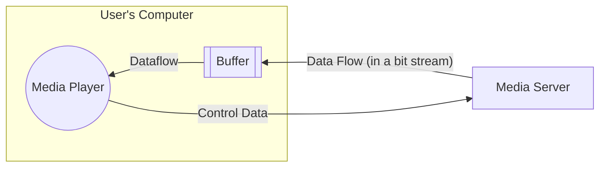

---
subject:
  - "[[Computer Science]]"
grade:
  - "[[AS Level]]"
related:
creation-date: 2025-01-09
up:
  - "[[Computer Science]]"
tags:
importance: 2
completion: "100.00"
modified:
  - 2025-08-30
  - 2025-05-05
  - 2025-05-04
  - 2025-05-03
  - 2025-05-01
  - 2025-04-20
  - 2025-04-14
  - 2025-04-12
  - 2025-04-07
marks-lost: 48
topical: "[[Networking Topical Paper]]"
---

> [!grey]- Syllabus
>  
> ---  
>  
> ## **Networking Basics**  
> - [x] Understand the **purpose and benefits** of networking devices  
> - [x] Differentiate between:  
>   - [x] **LAN (Local Area Network)**  
>   - [x] **WAN (Wide Area Network)**  
>  
> ---  
>  
> ## **Network Models**  
> - [x] Compare **Client-Server** vs. **Peer-to-Peer** models  
>   - [x] Roles of different computers  
>   - [x] Benefits & drawbacks  
>   - [x] Justify model use in given scenarios  
> - [x] Understand **Thin-Client** vs. **Thick-Client**  
>  
> ---  
>  
> ## **Network Topologies**  
> - [x] Know characteristics of:  
>   - [x] **Bus**  
>   - [x] **Star**  
>   - [x] **Mesh**  
>   - [x] **Hybrid**  
> - [x] Understand **packet transmission** in different topologies  
> - [x] Justify a topology for a given situation  
>  
> ---  
>  
> ## **Cloud & Network Types**  
> - [x] Understand **Cloud Computing**:  
>   - [x] Public vs. Private  
>   - [x] Benefits and drawbacks  
> - [x] Compare **Wireless** vs. **Wired Networks**  
>  
> ---  
>  
> ## **Transmission Media**  
> - [x] Describe characteristics of:  
>   - [x] **Copper Cable**  
>   - [x] **Fibre-optic Cable**  
>   - [x] **Radio Waves (WiFi)**  
>   - [x] **Microwaves**  
>   - [x] **Satellites**  
>  
> ---  
>  
> ## **LAN Hardware**  
> - [x] Identify and explain use of:  
>   - [x] **Hub**
>   - [x] **Switch**  
>   - [x] **Server**  
>   - [x] **NIC / WNIC**  
>   - [x] **WAP**  
>   - [x] **Cables, Bridge, Repeater**  
>   - [x] **Router** (role and function)  
>  
> ---  
>  
> ## **Ethernet & Collision Management**  
> - [x] Understand Ethernet  
> - [x] Explain **CSMA/CD** (Carrier Sense Multiple Access / Collision Detection)  
>  
> ---  
>  
> ## **Bit Streaming**  
> - [x] Differentiate between:  
>   - [x] **Real-time**  
>   - [x] **On-demand**  
> - [x] Importance of **bit rate** and **broadband speed**  
>  
> ---  
>  
> ## **WWW vs Internet**  
> - [x] Understand the differences  
> - [x] Describe internet hardware:  
>   - [x] **Modems**  
>   - [x] **PSTN**  
>   - [x] **Dedicated lines**  
>   - [x] **Cell phone network**  
>  
> ---  
>  
> ## **IP Addressing & DNS**  
> - [x] Understand format of 
>   - [x] IPv4
>   - [x] IPv6
> - [x] Explain **Subnetting**  
> - [x] Public vs. Private IP addresses and **security implications**  
> - [x] Static vs. Dynamic IP addresses  
> - [x] Use of **URL** and the role of **DNS** in locating resources on the WWW  
>   - [x] URL
>   - [x] DNS
>  


---
# Types of Networks
## LAN
![[Local Area Network|LAN]]
## WAN
![[Wide Area Network|WAN]]
# Types of Network Models
## Client Server Model
![[Client Server Model]]

## Peer-to-peer model
![[Peer to Peer model]]
# Networking Topologies
## Bus Topology
![[Bus Topology]]
## Star Topology
![[Star Topology]]
## Mesh Topology
![[Mesh Topology]]
## Hybrid Topology
> [!error] Hybrid Topology
> **Hybrid Topology** :: A collection of connected LANs where some of them have different topologies or supporting technologies

### Advantages 
1. Handle large volumes of traffic
2. Easy to identify where a network fault has occurred
3. Well suited to create larger networks

### Disadvantages
1. Complex to install and maintain


# Data Transmission Media


## Wired
- Faster connection and greater bandwidth
  - Stream/download larger files
  - less latency 
- More reliable and stable connection
  - less interference
- More secure
### Twisted Pair
- Uses copper
- Lowest data transfer rate
- Susceptible to interference
- Cheap
- Used in LANs

- 2 types **shielded** and **unshielded**
- Shielded cable has *thin metal foil jacket*
	- Cancels out some interference
	- Used commercially


### Fibre Optic
![[Pasted image 20250330200713-1.png|float-right-small|400]]

- Uses light pulses to carry data
- Greatest transfer rate
- High cost
- Least attenuation or interference prone
- 26 000 times the speed of twisted pair

- Single-Mode
	- one light source
	- smaller central core
	- less reflections
	- Faster data travel over long distance
- Multi-Mode
	- Multiple light sources
	- More reflections
	- Better for shorter distances


### Co-axial
![[Pasted image 20250330194553-1.png|float-right-small]]
- Uses copper
- Cost more than twisted pair
- Better data transfer rate than  twisted pair
- Suffers for signal attenuation the greatest
- Best anti-jamming capabilities
- Used in MAN's and by television companies


## Wireless
- Allows freedom of movement
  - move from room to room whilst being connected
  - No need of a physical connection
- Easily expandable if more people want to use the network
- Less cabling and technical skill required
  - Lower initial cost

### Radio waves
- Carries data wirelessly
- In the form of electromagnetic waves

### Satellite
Advantages:
- Not fixed to a single location
- Allows access to internet in rural and remote areas

Disadvantages:
- High latency
- More expensive
- Signal effected by bad weather
- Slower transmission speed
- Direct line of sight needed
# LAN Hardware

> [!error] Hardware devices of networks
> **Repeater** :: Device that connects 2 cables and provides a full-strength signal to the second cable
> **Bridge** :: A device that connects 2 segments of a LAN
> **Network Interface Card** :: A component used to identify the end system
> **Switch** :: A connecting device that can send an unicast message
> **Wireless Access point** :: The connecting device in a WiFi LAN
> **Wireless Network Interface Card** :: Provides the NIC function in a WiFi LAN

## Hub
> [!none|float-right-medium]
> ```mermaid
> graph LR
>   START:::hidden -->|Incoming data packet| HUB[HUB]
>   A[Computer]
>   B[Computer]
>   C[Computer]
> 
>   HUB --> A
>   HUB --> B
>   HUB --> C
>   
> ```
- Multiple devices connected 
- Hub sends data packets received to every computer
- Not very secure as every computer gets the data packet 

- As data packet is received, it sends it to each computer, if the packet header has the same address as the recipient computer, the computer will receive it, else the data packet is ignored

--- 
## Switch
> [!none|float-right-medium]
> ```mermaid
> graph LR
>   START:::hidden -->|Incoming data packet| HUB[HUB]
>   A[Computer]
>   B[Computer]
>   C[Computer]
> 
>   HUB --> A
>   HUB --> B
>   HUB --> C
>   
> ```
- Switch is more efficient
- unlike hub a switch checks for the destination address and then sends it
- thus a switch is more secure


## Server
## NIC
- Allows the device to connect to networks
- Contains the devices MAC address
### WNIC
- Hardware component with antenna
- Provides interface to access wireless network
- Provides a MAC address to a device to identify it on a wireless network
- Receives analogue radio waves
  - Converts it into digital binary data
- Checks or transmissions from correct MAC / IP address
- Ignores all irrelevant transmissions
- Encrypts and decrypts data received
- Converts digital binary data into analogue waves and sends via antenna


## WAP
- Hardware component
- Provides radio wave communication from the central device to nodes on the network


## Bridge
- Connects one LAN to another LAN **with the same protocol**
- Connects different parts of LAN so that they can function together as one
## Repeater
- Upon long distance transfer, signals suffer from attenuation and signal loss
- Repeaters boost signals -> thus signals can travel long distances
- Amplifies signals on analogue (copper cable) and digital (fibre optic cables) communication links
- Can be used with WiFi (removes dead-zones)
- Non selective (they boost any signal)

- Only one collision domain
  - collisions may happen
  - Can be resolved using jamming signals
  - Which will reduce performance

# Internet Infrastructure
## Modems
- Modulator Demodulator
- Converts digital data to analogue data and vice versa
- Modems allows connection between public infrastructure and computers (so internet can be accessed)
- Allows connection to external network
## Router
- Receives packets from devices or the internet
- Routes packets to the destination
- Maintains a routing table
- Assigns private IP addresses 
- Acts as a gateway
- Performs protocol conversion
- Acts as a firewall
  

### Finding the destination
1. Each devices connected to the router is assigned a private IP address
2. A routing table with all the IP addresses are stored 
3. Header of data packet is checked to see if destination IP address is in the routing table
4. Most efficient path of transmission is found
5. Data packets only sent to destination

## PSTN
- Public Switched Telephone Network
- Used to connect devices and LANs across towns and cities
- Unlike internet calls via VoIP (Voice over Internet Protocol):
  - Connection is always open unless closed by both parties
  - Constant transmission of data whether data is being inputted or not

### Role of PSTN
- Consists of multiple types of communication lines
	- Therefore digital data needs to be converted into analogue data before hand (via modem)
- Data is transmitted in both directions at the same time (**Duplex data transmission**)
- Using PSTN, the communication is able to pass through different ISPs

## Dedicated lines
- Private
- Fixed bandwidth connection
- Always active
- Only customers can use the dedicated lines
- High reliability and performance
- Improved security
- Expensive to setup
- Disturbance to the dedicated lines would leave no alternative

## Cell Phone Network
- Connects networks over countries via satellites
- They do not suffer from signal attenuation
- 3 Types of satellites
  1. LEO -> Low Earth orbit ~1.5 hours orbit period
  2. MEO -> Medium Earth Orbit 2-12 hours orbit
  3. GEO -> 24 hours

# Ethernet
![[Ethernet]]

# Internet Applications
- Internet is a network of networks
- Stands of **inter**connected **net**work
- Uses TCP/IP protocol

## World Wide Web
- Internet is the **infrastructure** WWW is based on
- Collection of multimedia webpages
- http(s) protocols written using HTML
- URL specify location of all webpages
- WWW *uses* the internet to access information from servers and computers

## Cloud Computing

> [!tip] Cloud Types
> **Private Cloud** :: Owned by and only accessed by an organization
> **Public Cloud** :: Owned by a cloud provider for general access

> [!multi-column]
>
>> [!none]
>> Advantages:
>> 1. No need for separate high capacity storage devices
>> 2. Can access data from any computer with **internet access**
>> 3. Most cloud services have built in backup systems
>> 4. Potentially better security
>> 5. Can easily increase capacity of storage
>> 6. Data can be shared easily
>> 7. Multiple people can work on the same files
>
>> [!none]
>> Disadvantages:
>> 1. Only accessible via internet access
>> 2. No control over security
>> 3. No control over backups
>> 4. May take long time to **upload and download** data
>> 5. More expensive in the long term
>> 6. Cannot be accessed if server is down

### Private Cloud
- Cloud services offered over internet or private network
- Only available to select users
- Only accessible by the organization
- User and provider are the same
### Public Cloud
- Cloud computing services offered by 3rd party over the internet
- Open to anyone with appropriate equipment
## Bit Streaming

> [!error] Bit Streaming
> **Bit Streaming** :: contiguous sequence of digital bits sent over a network/internet
> **Real Time** :: Bit stream content is transmitted as it is produced
> **On-Demand** :: Bit stream content is transmitted at time chosen by an user
> **Bit Rate** :: Number of bits transmitted per second



1. Before transmission media is compressed
2. Transmission over internet from a *content server*
   - Content broken down into stream of bits via TCP or UDP
3. Receiver's end buffers
   - Media player receives data
   - Data stored in buffer
   - Buffer ensures continuous playback
4. Playback and adjustment
   - Media player fetches data constantly
   - If network speed drops, player switches to lower bitrate (adaptive streaming)
   - Buffer is never empty

| **Category** | **On-Demand Streaming**                        | **Real-Time Streaming**                         |
| ------------ | ---------------------------------------------- | ----------------------------------------------- |
| **Source**   | Digital files stored on a server               | Live event captured by camera and microphone    |
| **Encoding** | Files are encoded and uploaded to a server     | Video signal is encoded into a streaming format |
| **Access**   | Users access a link to download the file       | Live video is uploaded to a streaming server    |
| **Delivery** | Sent as a contiguous bit stream when requested | Sent as a live feed directly to users           |
| **Controls** | Users can pause, rewind, and fast forward      | No pause, rewind, or fast forward options       |


### Buffer
- ! Buffer is a **Temporary storage area** in a device which holds incoming data before it is processed
- Buffer has *Low watermark* and *high watermark*
- If buffer is near high watermark, data retrieval speed slows down to avoid overflowing
- If buffer is near low watermark, player pauses to request for more data

### Bit rate and its importance
- Higher bitrate = higher media quality
- Higher bitrate requires higher broadband

### Broadband and its importance
- @ Broadband speed is ther internet speed avalible for data transmission
- If broadband speed is lower than required bitrarte -> media will stutter
# IP Addressing
## IPv4
- Based on 32 bits
- gives $2^{32}$ possible addresses
- Represented in denary
- 32 bits split into groups of 8 bits (each group having range from 0 to 255)
- These group of bits are either categorized as netID's or hostID's
- Number of octets (groups of 8 bits) that are netID or hostID depends on the **Network Class**


> [!none|float-right-medium]
> ![[Networking 2025-04-05 20.47.08.excalidraw]]


| **Class** | **Network ID** | **Host ID**   | Example          | Network Size   |
| --------- | -------------- | ------------- | ---------------- | -------------- |
| **A**     | 1st octet      | Last 3 octets | 10.**1.2.3**     | Very Large     |
| **B**     | 1st 2 octets   | Last 2 octets | 172.16.**1.5**   | Medium size    |
| **C**     | 1st 3 octets   | Last 1 octet  | 192.168.1.**25** | Small networks |


## IPv6
- Based on 128 bits
- Represented in Hexadecimal
- 128 bits split into 8 groups
- Each group can go from 0 to FFFF
## Sub netting
1. IP address made up of network ID and a host ID
2. Each subnet has its own subnet ID
3. Each device in a subnet has the same network IDbut unique host ID


Advantages of Sub Netting
- Reduce amount of traffic in a network
- Improve network speed
- Improves network security
  - Devices in one subnet cannot access areas outside subnet
- Allows for easier maintenance
  - As only one subnet may need to be taken down

### CIDR
- Classless Inter-Domain Routing
- Increases the flexibility of IPv4 by introducing a **8 bit suffix** at the end of the IP address
- $ xxxx.xxxx.xxxx.xx/yy has yy bits for netID 
![[Pasted image 20250405210450-1.png|400]]
## Public IP Address
- Assigned by ISP
- Can be accessed by anyone using the internet
- Used to get internet service
- All public IP addresses must be unique throughout the whole internet
## Private IP Address
- Assigned by router
- Cannot by accessed through the internet
- Used to communicate within a network
- Private IP only unique within local network
- More secure than public IP addresses
- NAT needed to access internet 
## Static IP Address
- IP address constant
- IP doesn't change upon rejoining the network
- Static IP assigned by ISP 
## Dynamic IP Address
- Dynamic IP address assigned by OS
- IP changes when device rejoins the network
# URL and DNS
- URL -> Uniform Resource Locator
- Format -> **protocol**://**Website Address**/**Path**/**Filename**
- Parts of a website address:
  1. Domain Host
  2. Domain Name
  3. Domain Type
  4. Country Code
- **protocol**://**host**(www).**domain_name**.**domain_type**.**country_code**/**path**/**file**.**type**

## DNS
- Domain Name System
- Holds a list of domain names and their corresponding IP address

## Domain to IP conversion
1. URL is parsed to obtain the domain name
2. Domain name is sent to the nearest DNS server
3. Domain name *resolver* searched database for the domain name
   - If not found, request is forwarded to a higher-level DNS
4. IP address is returned
5. If not found then error message is shown


```dataviewjs
const file = dv.current();
const checkboxes = file.file.tasks;
const totalCheckboxes = checkboxes.length;
const completedCheckboxes = checkboxes.filter(t => t.completed).length;


const completionPercentage = totalCheckboxes > 0 
    ? ((completedCheckboxes / totalCheckboxes) * 100).toFixed(2) 
    : "0.00";
console.log(totalCheckboxes, completedCheckboxes, completionPercentage)
try {
    await app.fileManager.processFrontMatter(dv.app.vault.getAbstractFileByPath(file.file.path), (frontmatter) => {
        frontmatter["completion"] = completionPercentage;
    });
    console.log("✅ Frontmatter updated successfully!");
} catch (error) {
    console.log(`❌ Error updating frontmatter: ${error}`);
}
```